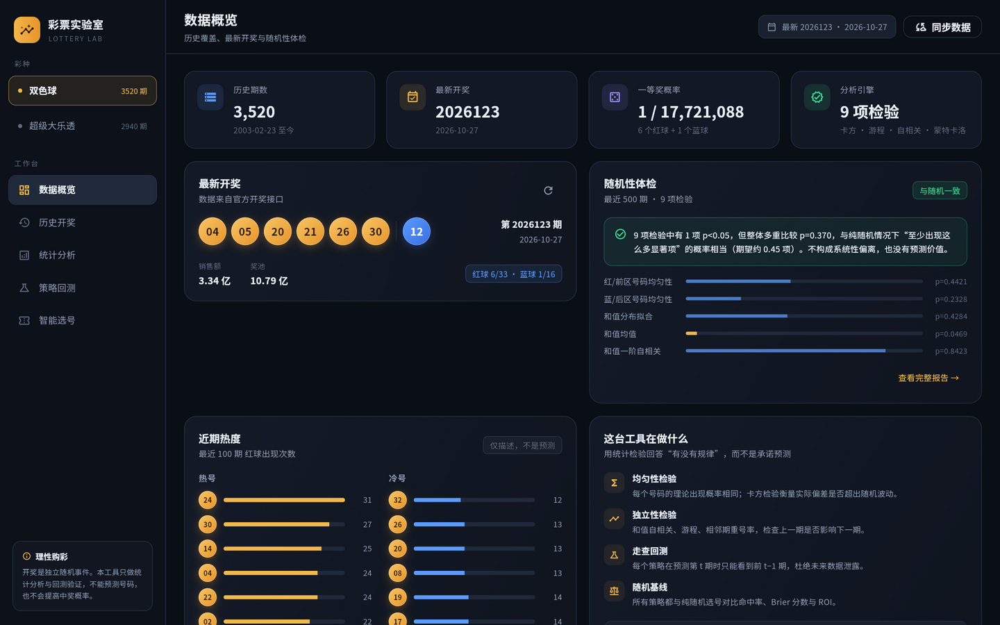
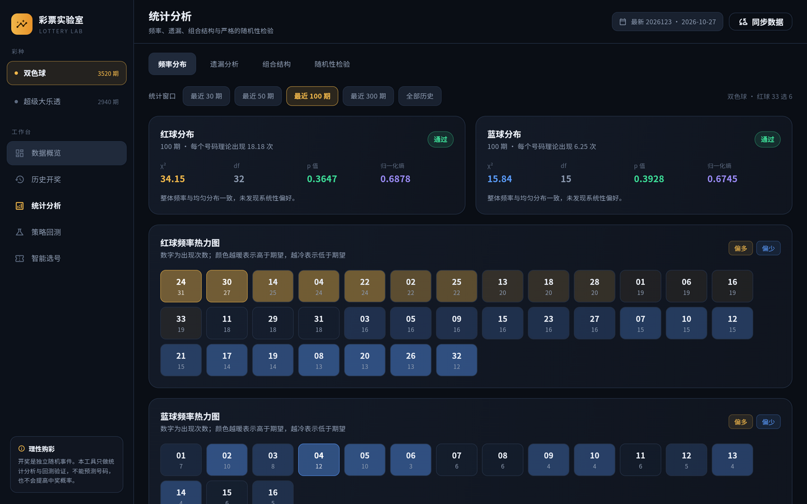
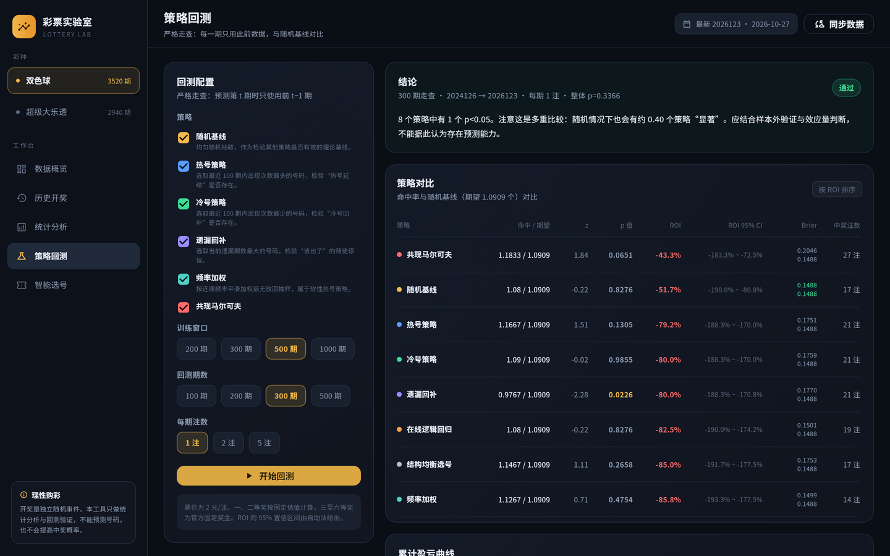
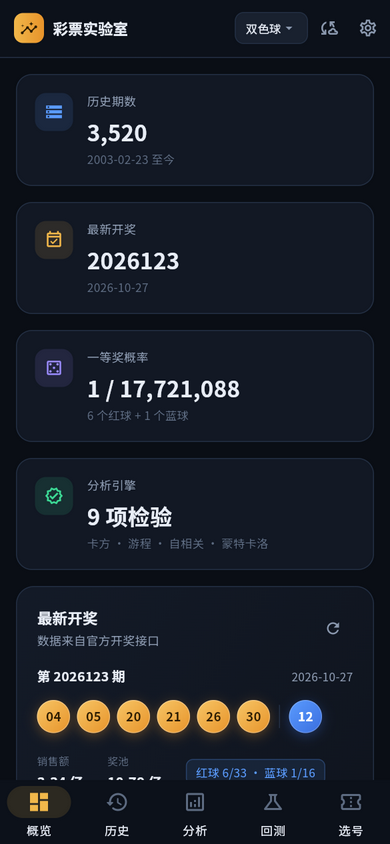
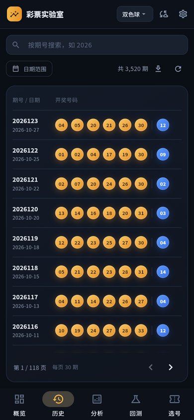

# 彩票实验室 · Lottery Lab


一个**不承诺预测**的彩票数据分析与回测工具。后端 Rust，前端 Flutter（Windows 桌面 + Web + Android）。

支持中国福利彩票「双色球」与中国体育彩票「超级大乐透」，内置 2003 年至今的官方历史数据同步、频率/遗漏/组合结构分析、9 项随机性检验，以及 8 个选号策略的严格走查回测。

> 彩票开奖是独立随机事件。任何选号方法都不会提高中奖概率。本工具的价值在于**用统计检验回答“到底有没有规律”**，并把结果诚实地摆出来。



| 频率热力图 | 策略回测 |
|---|---|
|  |  |

| 手机 · 数据概览 | 手机 · 历史开奖 |
|---|---|
|  |  |

---

## 功能

### 数据
- 双色球：福彩官方接口（2013 至今）+ 500.com 历史表补齐 2003–2012，共 3520 期
- 超级大乐透：体彩官方接口，2007 年至今 2940 期
- 本地 SQLite 缓存，支持一键同步、按期号检索、日期范围筛选、分页浏览、CSV 导出
- **Android 内置引擎**：APK 内直接运行同一套 Rust 后端与 SQLite 数据库，首次启动自带完整历史，离线也能做全部分析与回测；联网时可在手机上直接同步官方数据，不再依赖电脑

### 统计
- **频率分布**：每个号码的出现次数、z 分数、当前遗漏、平均/最大间隔、χ² 均匀性检验、归一化熵
- **遗漏分析**：当前遗漏排序、理论平均间隔、历史最大遗漏
- **组合结构**：和值分布与精确组合分布对比、奇偶、大小、连号、跨度、AC 值
- **随机性检验（9 项）**：号码均匀性、和值分布拟合、和值均值 z 检验、一阶自相关、游程检验、相邻期重号、号码间隔几何分布、Shannon 熵、蒙特卡洛校准
- **多重比较校正**：9 项检验同时进行时，用二项分布计算“至少出现这么多显著项”的整体概率，避免把正常的假阳性当成规律

### 回测
- 8 个策略：随机基线、热号、冷号、遗漏回补、频率加权、共现马尔可夫、在线逻辑回归、结构均衡选号
- **严格走查**：预测第 t 期时只使用前 t−1 期数据，无未来数据泄露
- 指标：平均命中 vs 理论期望、z 值、p 值、ROI 及自助法 95% 置信区间、Brier 分数 vs 随机基线、奖级分布、累计盈亏曲线
- 结果会明确告诉你：没有任何策略能稳定跑赢随机基线

### 选号与验奖
- 按策略生成号码，支持一次多注、一键复制
- **手选验奖**：选择已开奖期次，点选号码后显示命中号码、奖级与奖金；一、二等奖按长期估算值标注
- 生成结果附带概率说明与免责声明

### 我的彩票
- **按注记录**：一注一行，记录彩种、期号、号码、倍数、备注；重复录入自动去重
- **追号**：同一注号码连买 1/2/3/5/10 期，展开为独立记录各自对奖
- **自动对奖**：后端每次拉到新开奖就结算该期所有待开奖的注，纯本地计算、不额外请求网络。桌面端常驻后端约 10 分钟内完成；App 端在启动、切前台和每 5 分钟兜底补对
- **总账**：总投入 / 总奖金 / 净收益，按奖级分组的统计
- **浮动奖金**：一、二等奖先按长期均值估算并标注，到账后可手工改成实际金额，重算对奖不会覆盖它

---

## 技术栈

| 层 | 技术 |
|---|---|
| 后端 | Rust 2024 · axum 0.8 · rusqlite（bundled） · reqwest · rand/ChaCha8 |
| 移动端 | 同一后端编译为 `cdylib`，通过 Dart FFI 在 App 进程内启动 loopback HTTP 服务 |
| 前端 | Flutter 3.47 · Dart 3.13 · fl_chart · http |
| 数据 | SQLite（WAL 模式，`backend/data/lottery.db`；Android 使用 App 私有目录） |
| 字体 | Noto Sans SC 子集（内置，约 1.2 MB/字重，SIL OFL） |

---

## 快速开始（Windows）

### 环境
- Rust 1.85+（`backend/Cargo.toml` 使用 `edition = "2024"`，需 1.85 及以上；`cargo --version`）
- Flutter 3.35+，并启用 Windows 桌面支持（`flutter doctor`）
- Visual Studio 2022 生成工具（Flutter Windows 构建需要）

### 运行

```bat
:: 1. 启动后端（首次启动会自动同步历史数据，约 30 秒；之后每 10 分钟自动检查最新一期）
cd backend
cargo run

:: 2. 另开一个终端，启动桌面应用
cd frontend
flutter run -d windows
```

或者直接双击根目录的 `run.bat`：它会启动后端并打开已构建的桌面程序（若尚未构建则回退到 `flutter run`）。

后端会常驻后台做增量同步：每 10 分钟抓取官方最新一页并写入 SQLite，开奖后无需手动点「同步数据」。间隔可用环境变量 `LOTTERY_SYNC_INTERVAL_SECS` 调整（最小 60 秒）。

### 构建发布版

```bat
build.bat
```

产物：
- 后端：`backend/target/release/lottery_lab_backend.exe`
- 桌面端：`frontend/build/windows/x64/runner/Release/lottery_lab_app.exe`

应用图标（烧瓶 + 三色彩票球）由脚本生成，改动设计后运行：

```bat
python tools\\make_icons.py
```

### Web 模式

```bat
cd frontend
flutter build web --release
```

后端启动时会自动把 `frontend/build/web` 挂到 `http://127.0.0.1:8787/`，浏览器直接打开即可。

### Android APK

APK 内置了 Rust 后端和一份完整历史数据库，**不需要电脑**即可使用：

1. 安装 `frontend/build/app/outputs/flutter-apk/app-release.apk`。
2. 打开 App，首次启动会把 APK 内置的 `lottery.db` 复制到 App 私有目录（约 1 MB），随后直接加载数据。
3. 联网时后台每 10 分钟自动检查最新一期，开奖后无需手动操作；点右上角「同步数据」可立即全量同步。同步失败不影响已有历史。

如果确实想连接电脑上的后端（例如多人共用一份数据），在右上角齿轮 →「数据服务」里填写电脑地址并保存即可；随时可以切回「内置引擎」。

构建 APK：

```bat
:: 0. 首次构建需要 Rust 的 Android target（已装可跳过）
rustup target add aarch64-linux-android armv7-linux-androideabi x86_64-linux-android

:: 1. 刷新要打包进 APK 的种子数据库（需先同步过后端）
python tools\\refresh_seed_db.py

:: 2. 交叉编译 Rust 后端为 Android 动态库（需要 NDK）
python tools\\build_android_backend.py

:: 3. 构建 APK
cd frontend
flutter build apk --release
```

也可以直接双击 `build_android.bat`，它会依次完成上面三步并把 APK 复制到 `dist/lottery-lab-android.apk`。

> APK 约 79 MB（arm64-v8a / armeabi-v7a / x86_64 三个 ABI 都内置了后端）。只给自己手机装的话，可以用
> `flutter build apk --release --target-platform android-arm64` 生成更小的单 ABI 包。
> APK 使用 debug 签名，适合自己安装测试；上架应用商店需要换成正式签名。

---

## 配置

| 环境变量 | 默认值 | 说明 |
|---|---|---|
| `LOTTERY_DB` | `data/lottery.db` | SQLite 路径（相对后端工作目录） |
| `LOTTERY_ADDR` | `0.0.0.0:8787` | 监听地址（桌面/Web 或远程模式使用；手机内置引擎只监听 `127.0.0.1` 的随机端口） |
| `LOTTERY_WEB_DIR` | `../frontend/build/web` | Web 构建目录 |
| `API_BASE`（Flutter 编译期） | `http://127.0.0.1:8787` | 桌面/Web 的默认后端地址；Android 默认用内置引擎，此项仅作回退 |

---

## API 一览

| 方法 | 路径 | 说明 |
|---|---|---|
| GET | `/api/health` | 健康检查 |
| GET | `/api/games` | 彩种定义、期数、最新一期 |
| GET | `/api/draws?game=&page=&page_size=&q=&from=&to=` | 历史开奖分页 |
| GET | `/api/draws/{game}/{issue}` | 单期详情 |
| GET | `/api/draws/export?game=` | CSV 导出 |
| GET | `/api/stats/frequency?game=&window=` | 频率分布 |
| GET | `/api/stats/gaps?game=` | 遗漏 |
| GET | `/api/stats/combinations?game=` | 组合结构 |
| GET | `/api/stats/randomness?game=&window=&simulations=` | 随机性检验 |
| GET | `/api/strategies` | 策略列表 |
| POST | `/api/backtest` | 走查回测 |
| POST | `/api/tickets` | 生成号码 |
| POST | `/api/prize-check` | 手选号码验奖（`game`、可选 `issue`、`primary`、`secondary`） |
| GET | `/api/bets?game=&status=&page=&page_size=` | 购彩记录分页（`status` = `pending`/`won`/`lost`） |
| POST | `/api/bets` | 保存购彩记录（`game` + `bets` 数组，支持一次多注） |
| GET | `/api/bets/summary?game=` | 总投入 / 总奖金 / 净收益 / 奖级分布 |
| POST | `/api/bets/check` | 手动对奖（`full: true` 时重算已结算记录） |
| DELETE | `/api/bets/{id}` | 删除一条记录 |
| PATCH | `/api/bets/{id}/actual-amount` | 填写一、二等奖的实际到账金额 |
| POST | `/api/sync` | 同步官方数据 |
| POST | `/api/import` | 导入 CSV（`issue,date,primary,secondary`，号码空格分隔） |

回测请求示例：

```json
{
  "game": "ssq",
  "strategies": ["random", "hot", "cold", "overdue", "weighted", "markov", "logistic", "balanced"],
  "train_window": 500,
  "test_size": 300,
  "tickets_per_draw": 1,
  "seed": 42
}
```

---

## 数据说明与已知现象

- **一、二等奖为浮动奖金**。回测按双色球一等奖 700 万、二等奖 15 万，大乐透一等奖 1000 万、二等奖 15 万估算；三至六/九等奖为官方固定奖金。因此 ROI 只具有量级参考意义。
- **大乐透 2014 年前后的分布差异**：2007–2013 年前区号码明显偏向大号（χ²≈234，df=34），2014 年后恢复正常（χ²≈33.5）。这更可能是历史摇奖设备/规则变更，而不是可利用的规律。工具在「随机性检验」页提供了窗口切换（最近 300/500/1000 期/全部历史），并会在结论中提示非平稳性。
- **数据源**：福彩 `cwl.gov.cn`、体彩 `webapi.sporttery.cn`、500.com 历史表。网络失败时可在界面点「同步数据」重试。

---

## 测试

```bash
# 后端：统计函数、组合分布、策略合法性、回测基线
cd backend && cargo test

# 前端：组件与概率公式
cd frontend && flutter test
cd frontend && flutter analyze
```

当前状态：后端 37 个单元测试全部通过，前端 15 个测试通过，`flutter analyze` 无告警。

---

## 目录结构

```
lottery-lab/
├── backend/                  # Rust API 服务
│   ├── src/
│   │   ├── main.rs           # 独立服务：启动、静态文件、自动同步
│   │   ├── lib.rs            # 共享路由 / 自动同步，供桌面与手机复用
│   │   ├── embedded.rs       # C ABI：在 App 进程内启动 loopback 服务
│   │   ├── routes.rs         # REST 路由
│   │   ├── db.rs             # SQLite 封装
│   │   ├── models.rs         # Draw / Prediction
│   │   ├── config.rs         # 彩种定义、奖级表
│   │   ├── prize.rs          # 手选号码验奖：命中数 → 奖级 / 奖金
│   │   ├── bets.rs           # 购彩记录、自动对奖、总账统计
│   │   ├── sources.rs        # 官方数据抓取与 500.com 解析
│   │   ├── stats.rs          # 卡方、正态、gamma、游程、二项分布
│   │   ├── analysis.rs       # 频率、遗漏、组合结构、随机性检验
│   │   ├── strategies.rs     # 8 个策略
│   │   └── backtest.rs       # 走查回测与指标
│   └── data/lottery.db       # 运行时生成
├── frontend/                 # Flutter 应用
│   ├── lib/
│   │   ├── main.dart         # 侧边栏 + 页面框架
│   │   ├── api.dart          # HTTP 客户端
│   │   ├── app_state.dart    # 全局状态、内置/远程模式切换
│   │   ├── embedded/         # Dart FFI 启动内置 Rust 后端
│   │   ├── models.dart       # 数据模型
│   │   ├── theme.dart        # 深色主题
│   │   ├── pages/            # 概览 / 历史 / 分析 / 回测 / 选号 / 我的彩票
│   │   └── widgets/          # 球、面板、徽标、录入表单等
│   ├── assets/lottery.db     # 打包进 APK 的种子数据库
│   └── android/.../jniLibs/  # 交叉编译生成的 liblottery_lab_backend.so
├── tools/
│   ├── build_android_backend.py  # 编译 Android 动态库
│   ├── refresh_seed_db.py        # 刷新 APK 种子数据库
│   ├── make_icons.py             # 生成应用图标
│   └── subset_font.py            # 生成中文字体子集
├── docs/                     # 截图
├── LICENSE / THIRD_PARTY_NOTICES.md / CONTRIBUTING.md
├── SECURITY.md / CODE_OF_CONDUCT.md / CHANGELOG.md
├── .github/                  # Issue 与 PR 模板
├── run.bat                   # 启动后端 + 桌面端
├── build.bat                 # 构建桌面 / Web 发布版
└── build_android.bat         # 构建内置引擎 APK
```

---

## 免责声明

本项目仅用于统计学习与数据分析，不构成任何购彩建议。彩票具有随机性与负期望，请理性购彩、量力而行；未成年人不得购买彩票。

---

## 许可证

本项目源码采用 [MIT](LICENSE) 许可。

仓库内包含的第三方资产（Noto Sans SC 字体子集、公开开奖数据）**不适用** MIT，
其来源与各自许可见 [THIRD_PARTY_NOTICES.md](THIRD_PARTY_NOTICES.md)。

- 贡献前请阅读 [CONTRIBUTING.md](CONTRIBUTING.md)（含不可退让的技术约束）
- 安全漏洞请按 [SECURITY.md](SECURITY.md) 私下报告，不要开公开 issue
- 参与行为受 [CODE_OF_CONDUCT.md](CODE_OF_CONDUCT.md) 约束
- 版本变更记录见 [CHANGELOG.md](CHANGELOG.md)
